# Hydroelectric Power Plant Digital Twin

[](https://colab.research.google.com/drive/1ED0UvC2BEQs61SqC-mtNv_xYVgMCI7TN?usp=sharing)


**A MATLAB and Simulink modelling study referencing Kavşak Bendi Hydroelectric Power Plant (HEPP).**

This educational engineering project brings together the main hydropower energy-conversion chain: water flow and net head, turbine and generator efficiencies, unit-level generation, reservoir balance, operating scenarios, transformer calculations, grid interface, and illustrative protection logic.

> **Important:** This is an educational simulation and portfolio project. It is not connected to plant SCADA or live operating data. Parameters that are not supported by verified plant records are model assumptions. Protection thresholds are illustrative and must not be used as real relay settings or operating instructions.

## Project at a glance

| Item | Reference value used in the model |
|---|---:|
| Main generating units | 3 Francis turbines |
| Ecological-flow unit | 1 unit |
| Main unit rating | 61.95 MW each |
| Ecological unit rating | 5.43 MW |
| Total installed capacity | 191.28 MW |
| Gross head | 100 m (assumption) |
| Hydraulic losses | 5 m (assumption) |
| Net head | 95 m |
| Turbine efficiency | 0.90 (assumption) |
| Generator efficiency | 0.96 (assumption) |
| Overall efficiency | 0.864 |
| Reference total flow | approximately 237.55 m³/s |

The reference unit ratings and the resulting total capacity are project inputs. They have not been independently verified against official plant design records in this repository.

## Main project components

- **Google Colab:** Python-based calculations and analysis, linked from the [`Colab/`](Colab/README.md) folder.
- **MATLAB:** `Plant_Model.m` contains the calculation workflow, operating scenarios, reservoir balance, generator and transformer calculations, grid interface, and illustrative protection checks.
- **Simulink:** `HPP_Digital_Twin_Model.slx` contains a block-diagram model with hydraulic/reservoir, turbine-generator, transformer/grid, and protection subsystems.
- **Reports:** English and Turkish project and technical reports are provided in both PDF and editable DOCX formats.
- **Results:** MATLAB figures (37), Python companion figures and CSV tables document the model outputs and scenarios.
- **Assets:** Simulink screenshots supplied with the project.

## Repository structure

```text
Hydroelectric-Power-Plant-Digital-Twin/
├── Colab/
│   └── README.md
├── MATLAB/
│   ├── Plant_Model.m
│   ├── Export_Results.m
│   └── README.md
├── Simulink/
│   ├── HPP_Digital_Twin_Model.slx
│   └── README.md
├── Reports/
│   ├── English/
│   └── Turkish/
├── Results/
│   ├── Figures/
│   ├── Tables/
│   ├── MATLAB_Output/
│   │   └── Figures/
│   └── generate_figures.py
├── Assets/
├── Documentation/
├── README.md
├── requirements.txt
├── LICENSE
└── .gitignore
```

## Getting started

### Google Colab

Open the notebook with the badge at the top of this page or from [`Colab/README.md`](Colab/README.md) and run the cells in order.

### MATLAB

1. Install MATLAB. MATLAB R2023b or a later compatible release is recommended for the supplied Simulink model.
2. Open the repository folder in MATLAB.
3. Open `MATLAB/Plant_Model.m` and run the script.
4. Review the command-window tables and generated figures.
5. To export figures and selected result tables, run `MATLAB/Export_Results.m` after confirming that `Plant_Model.m` runs successfully. The automatic exports are written to `Results/MATLAB_Output/Auto_Export/`.

### Python (companion figures and tables)

```bash
pip install -r requirements.txt
python Results/generate_figures.py
```

### Simulink

1. Open `Simulink/HPP_Digital_Twin_Model.slx` in Simulink.
2. Inspect the top-level subsystems and their internal block connections.
3. Run the model using the configured simulation settings.
4. Compare the model structure with the screenshots in `Assets/` and the technical report in `Reports/`.

The model may require minor compatibility adjustments when opened in a different MATLAB/Simulink release.

## Selected results

The supplied reference model gives approximately:

- Hydraulic power: **221.39 MW** at 237.55 m³/s and 95 m net head.
- Electrical power after 90% turbine and 96% generator efficiencies: approximately **191.28 MW**, limited by the reference installed capacity.
- Daily energy for the example 24-hour unit-availability schedule: **3,847.32 MWh**.

These are model outputs based on the stated assumptions and schedule, not measured plant production.

## Results

### MATLAB figures

The figures below are exported from `MATLAB/Plant_Model.m`. All 37 MATLAB figures, with a short description of each, are listed in [`Results/MATLAB_Output/`](Results/MATLAB_Output/README.md).

#### Sensitivity analysis

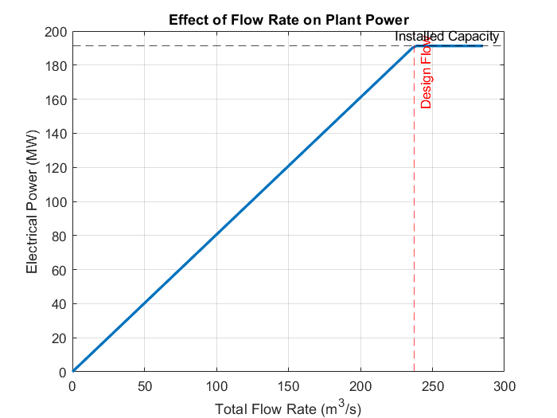

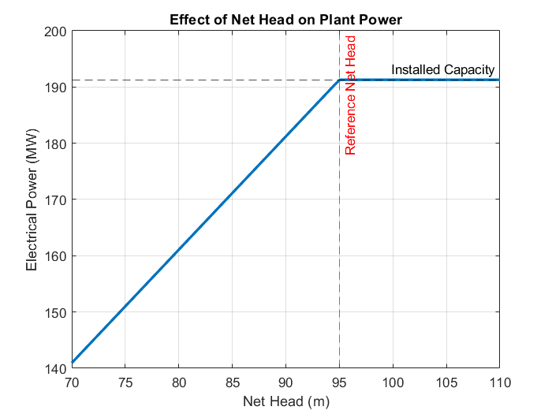

#### Turbine performance and 24-hour operation

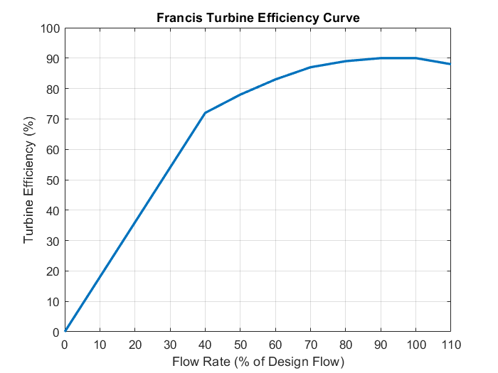

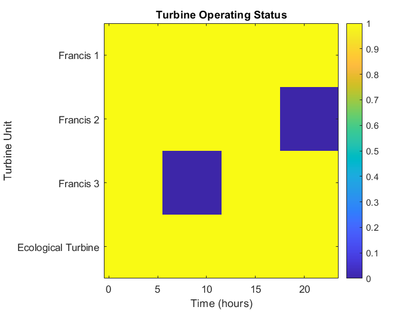

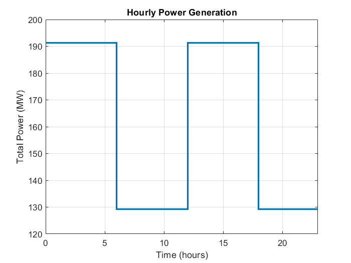

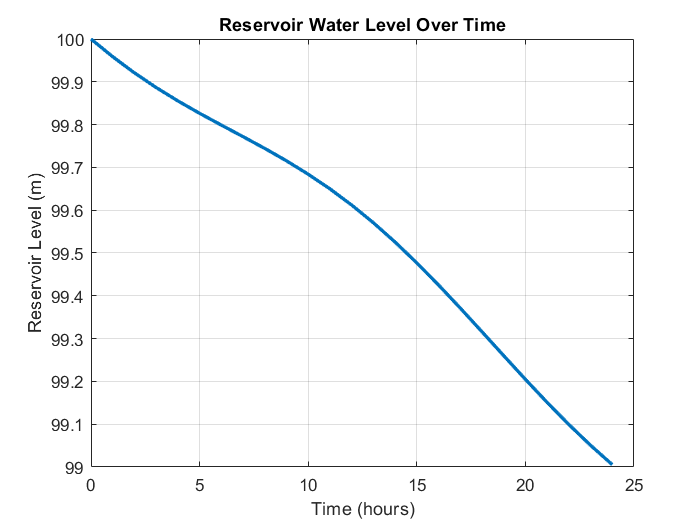

#### Generator, transformer and grid

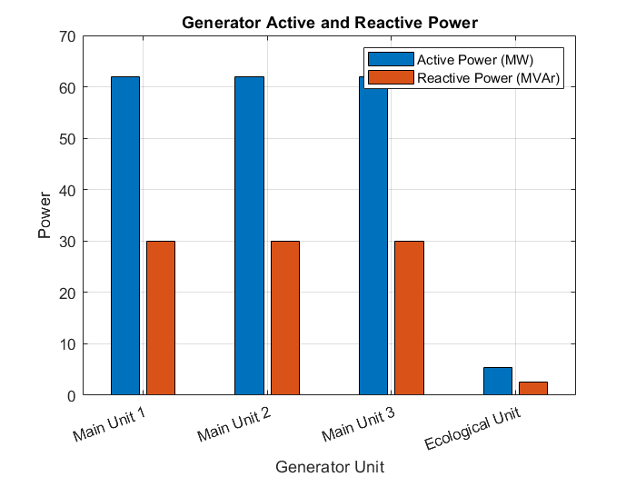

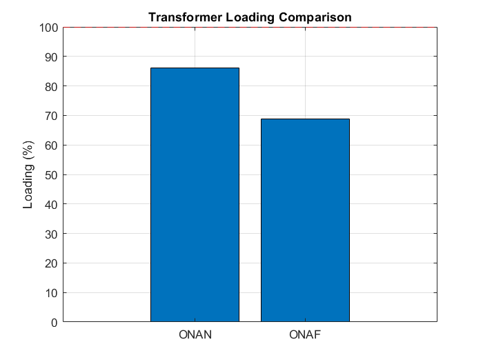

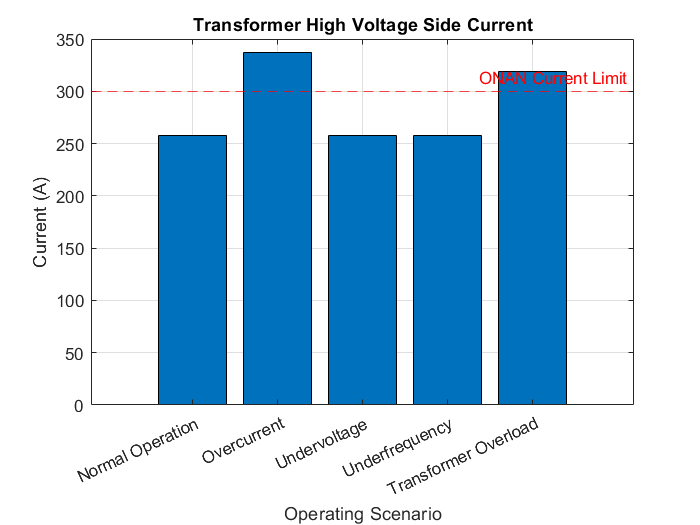

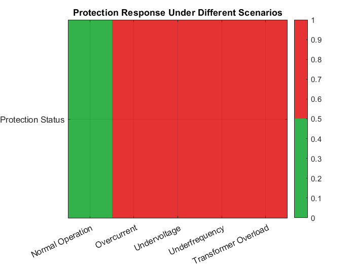

#### Integrated operating scenarios

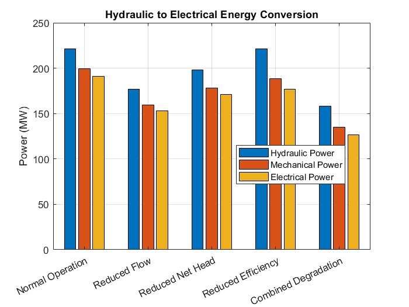

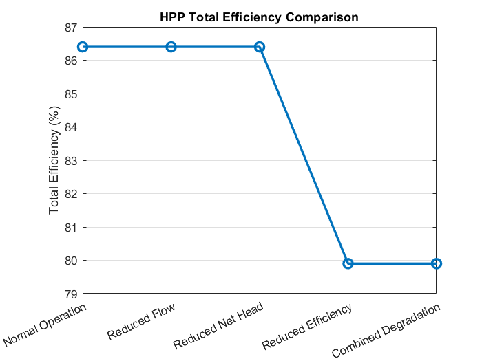

### Python companion figures and tables

`Results/Figures/` contains nine additional charts, and `Results/Tables/` the matching CSV tables. They are generated by `Results/generate_figures.py` from the same equations and reference parameters, and agree with the MATLAB results (for example 191.28 MW at the reference flow, 129.33 MW with one main unit out, and 86.4 % / 79.9 % overall efficiency for the normal and reduced-efficiency scenarios).

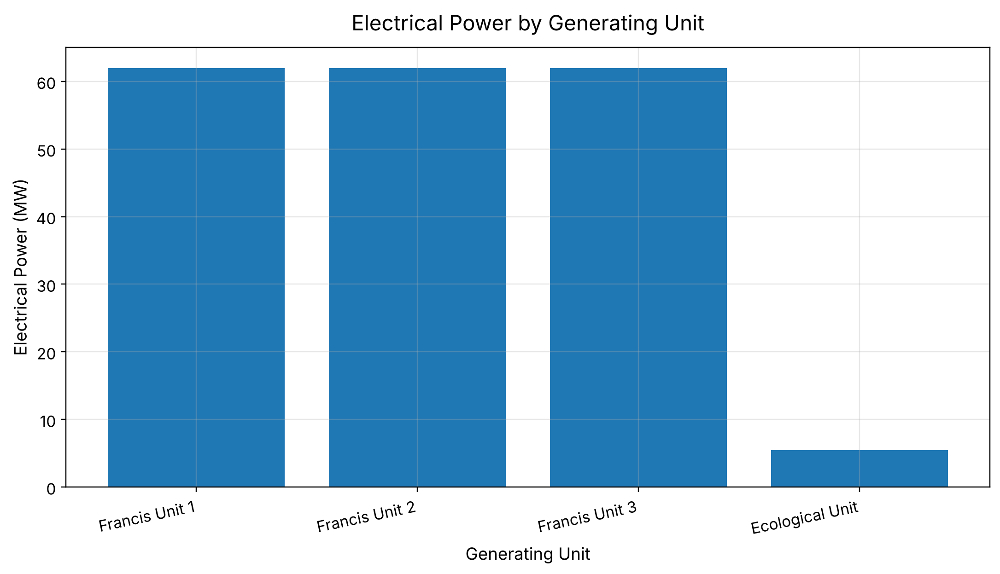

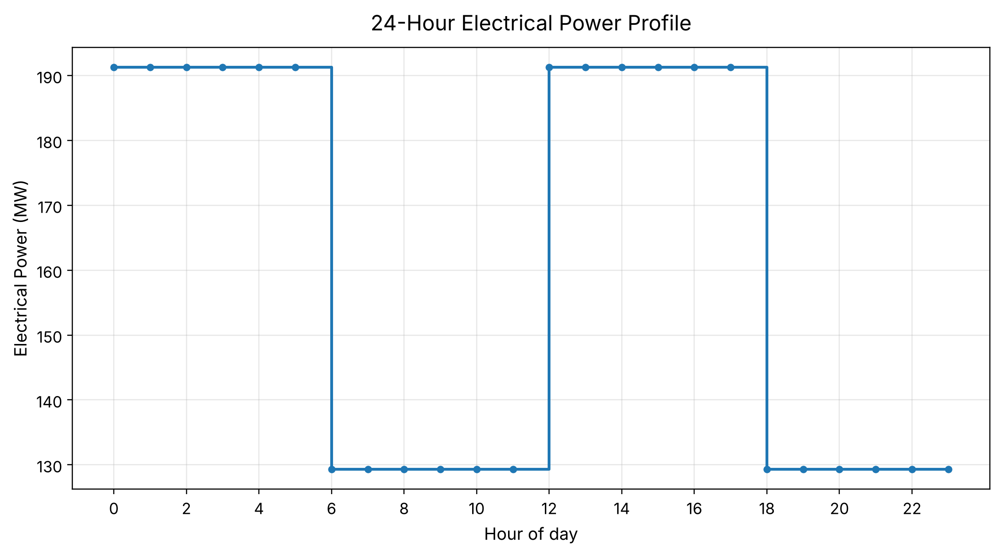

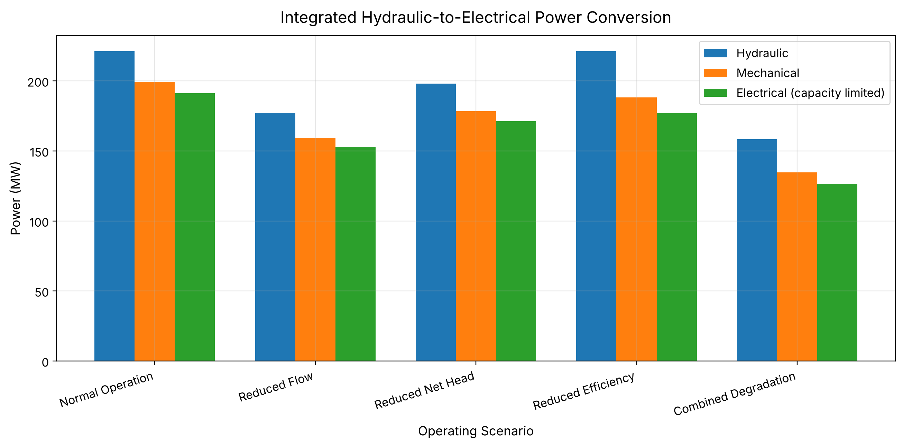

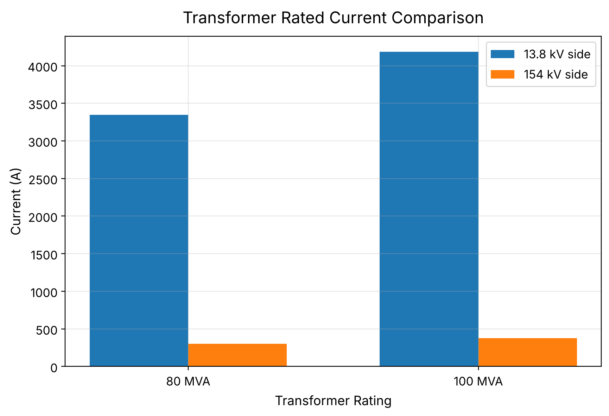

## Reports

| Report | English | Türkçe |
|---|---|---|
| Project report | [PDF](Reports/English/Hydroelectric_Power_Plant_Digital_Twin_Project_Report.pdf) · [DOCX](Reports/English/Hydroelectric_Power_Plant_Digital_Twin_Project_Report.docx) | [PDF](Reports/Turkish/Hidroelektrik_Guc_Santrali_Dijital_Ikiz_Projesi_Raporu.pdf) · [DOCX](Reports/Turkish/Hidroelektrik_Guc_Santrali_Dijital_Ikiz_Projesi_Raporu.docx) |
| Kavşak Bendi HPP technical report | [PDF](Reports/English/Kavsak_Bendi_HPP_Technical_Report_EN.pdf) · [DOCX](Reports/English/Kavsak_Bendi_HPP_Technical_Report_EN.docx) | [PDF](Reports/Turkish/Kavsak_Bendi_HES_Teknik_Rapor_TR.pdf) · [DOCX](Reports/Turkish/Kavsak_Bendi_HES_Teknik_Rapor_TR.docx) |
| MATLAB technical report | [PDF](Reports/English/MATLAB_Technical_Report_EN.pdf) · [DOCX](Reports/English/MATLAB_Technical_Report_EN.docx) | [PDF](Reports/Turkish/MATLAB_Teknik_Rapor_TR.pdf) · [DOCX](Reports/Turkish/MATLAB_Teknik_Rapor_TR.docx) |
| Simulink technical report | [PDF](Reports/English/Simulink_Technical_Report_EN.pdf) · [DOCX](Reports/English/Simulink_Technical_Report_EN.docx) | [PDF](Reports/Turkish/Simulink_Teknik_Rapor_TR.pdf) · [DOCX](Reports/Turkish/Simulink_Teknik_Rapor_TR.docx) |

## Assumptions and limitations

- No live SCADA or verified time-series operating data are included.
- Turbine and generator efficiencies are simplified fixed values in selected analyses.
- Reservoir behaviour is represented by a simplified volume balance; actual elevation-area-storage curves and waterway transients are not modelled.
- Transformer and transmission-line examples use stated illustrative assumptions. The actual plant single-line diagram and equipment arrangement require verification.
- Protection thresholds and fault scenarios are educational examples, not real protection settings.
- A complete load-flow, short-circuit, transient-stability, and grid-code compliance study is outside the current scope.

See `Documentation/Model_Assumptions.md` and the technical reports for further details.

## Author

**Duran Ali Toklu**  
Project focus: hydropower generation, MATLAB, Simulink, Python, and power-system analysis.

## License

The source code and documentation in this repository are provided under the MIT License. Third-party software and trademarks remain the property of their respective owners.
